<div align="center">

# 🌊 Submarine Saga 🚢

### ⚓ A Torpedo Duel under the Waves ⚓

**A 2D submarine battle game built from scratch with Python & OpenGL**


<br>


🎓 *CSE423 Computer Graphics Project — BRAC University*
👨‍💻 *By **Faiaz Abrar Zaman Pronoy** & **Sinthia Khandoker***

<br>

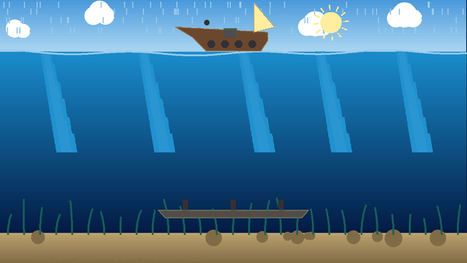

</div>

---

<div align="center">

## 🎬 Watch the Gameplay Video

https://github.com/user-attachments/assets/a4dba5c5-9015-4feb-988a-f61c02cfbee7

*A quick 47-second look at the game* ⏱️

🎥 **Want to see everything?** Watch the
**[full 2-minute tour](https://github.com/FaiazPronoy/Submarine_Saga/releases/download/v2.0/SubmarineSaga-full-showcase.mp4)** —
every mode, every level and every feature.

</div>

<div align="center">

### 🔗 Quick Links

[**⬇️ Download for Windows**](https://github.com/FaiazPronoy/Submarine_Saga/releases/latest) &nbsp;•&nbsp;
[**🎮 Controls**](#-controls) &nbsp;•&nbsp;
[**📸 Snapshots**](#-snapshots) &nbsp;•&nbsp;
[**🧠 Graphics**](#-computer-graphics-used) &nbsp;•&nbsp;
[**🚀 Run It**](#-getting-started)

</div>

---

## 📖 About

**Submarine Saga** is a fast underwater battle game. Two submarines fight with torpedoes while
dodging depth charges, mines and a hungry shark. 🦈

Play against the **computer** 🤖 or a **friend** 👥 on the same keyboard.

✨ The special part: **every shape on screen is drawn point by point** using classic computer
graphics algorithms we wrote ourselves — no images, no ready-made shapes, no game engine.

---

## ✨ Features

### 🎮 Game Modes
- 🤖 **1 Player** — fight the computer
- 👥 **2 Players** — fight a friend on one keyboard
- 📊 **3 Levels** — Easy, Normal and Hard
- 🏆 **Saved Record** — wins, losses and your best win streak

### 💥 Weapons & Moves
- 🚀 **Light Torpedo** — 1 damage, fast reload
- 💣 **Heavy Torpedo** — 3 damage, slow reload, follows the enemy on Hard
- 🎯 **Free Aiming** — turn your tube to any angle, and it stays there
- 🔴 **Smart Sight** — a dotted line shows your shot and turns **red** on a hit
- ⚡ **Dash** — a quick burst of speed to escape
- 🎈 **Decoy** — tricks a heavy torpedo into chasing it

### 🌊 The Sea
- 💣 **Depth charges** — yellow marks show where they will land
- ⚫ **Mines** — drift around; shoot them to clear the way
- 🦈 **Shark** — its fin warns you before it attacks
- 🛳️ **Shipwreck** — blocks torpedoes, use it as cover

### 🎁 Power-ups
| | Power-up | Effect |
|:---:|---|---|
| ❤️ | **Health** | +3 lives |
| 🛡️ | **Shield** | Blocks the next hit |
| ⚡ | **Rapid Fire** | Reload twice as fast |
| 💨 | **Speed** | Move faster |

### 🎯 Battle Rules
- ❤️ **10 lives** each
- 🏁 **Win 2 rounds** to win the match
- ⚠️ **Red warning** a second before a torpedo hits
- 🔥 **Last Stand** — at 2 lives you get faster
- ☠️ **Sudden Death** after 1 minute — the sea gets angry!

### 🎨 Look & Feel
- 📡 Animated **sonar intro**
- 🌙 **Day & night** modes
- 💥 Explosions, bubbles, smoke, splashes and 🎆 fireworks
- 🐢 **Slow motion** on the final hit
- 🔊 Sound effects
- 🖥️ Works in **any window size**, even full screen

---

## 📊 Levels

| Feature | 🟢 Easy | 🟡 Normal | 🔴 Hard |
|---|:---:|:---:|:---:|
| 🚀 Light torpedo | ✅ | ✅ | ✅ |
| 💣 Heavy torpedo | ❌ | ✅ | ✅ *homing* |
| 💥 Heavy torpedo blast | ❌ | ❌ | ✅ |
| 🎈 Decoy | ❌ | ❌ | ✅ |
| 🤖 Computer skill | 😌 Calm | 😐 Medium | 😈 Sharp |

---

## 🎮 Controls

| Action | 🟢 Player 1 | 🔴 Player 2 |
|---|:---:|:---:|
| 🧭 Move & aim | `W` `A` `S` `D` | `↑` `←` `↓` `→` |
| 🚀 Torpedo | `Space` | `P` |
| 💣 Heavy torpedo | `F` | `O` |
| ⚡ Dash | `E` | `L` |
| 🎈 Decoy | `Q` | `K` |

| Key | Action |
|:---:|---|
| `H` | ❓ Help |
| `I` | ⏸️ Pause |
| `R` | 🔄 Restart |
| `N` | 🌙 Day / Night |
| `M` | 🔊 Sound On / Off |
| `Esc` | 🏠 Main Menu |

> 💡 **Playing alone?** You can use either set of keys.

---

## 🕹️ How to Play

1. 🏠 Choose **1 Player** or **2 Players**, then pick a level
2. 🧭 Move with your keys — your torpedo tube turns with you
3. ✋ Let go — the tube **stays** at that angle
4. 🔴 When the dotted sight turns **red**, fire! 🚀
5. 🏃 Keep moving and watch for the ⚠️ red warning
6. 🏆 Sink the enemy twice to **win the match**

---

## 📸 Snapshots

<div align="center">

| 🏠 Title Screen | ❓ How to Play |
|:---:|:---:|
| 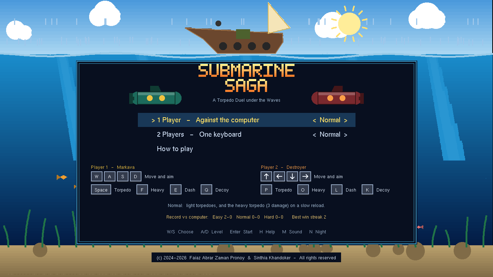 | 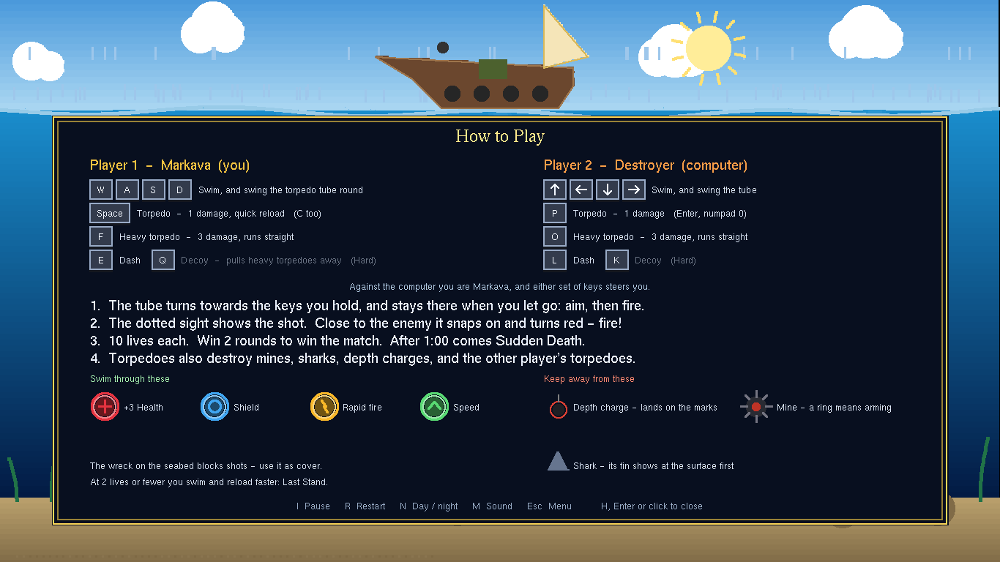 |
| 💣 **Heavy Torpedo Hit** | 🎈 **Decoy vs Homing Torpedo** |
| 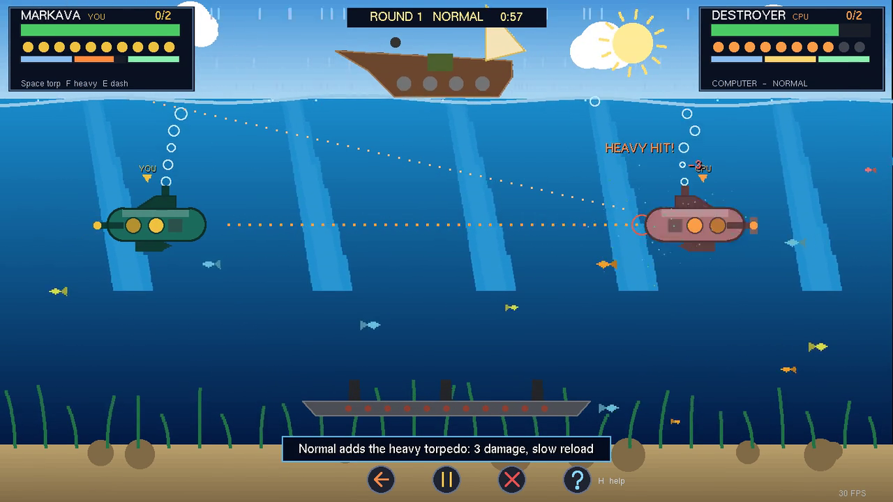 | 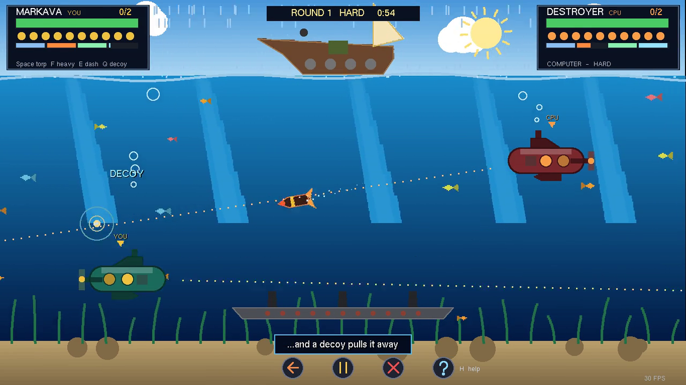 |
| 🎯 **Free Aim & Red Sight** | 🦈 **Shark Down** |
| 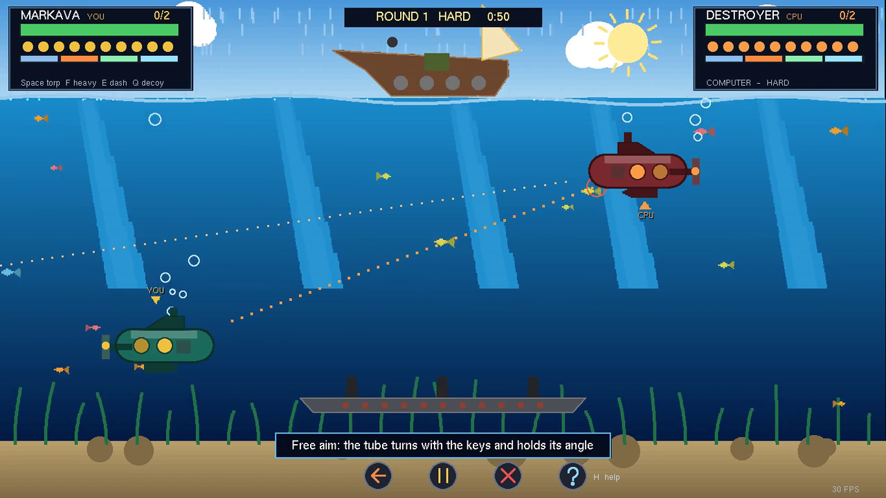 | 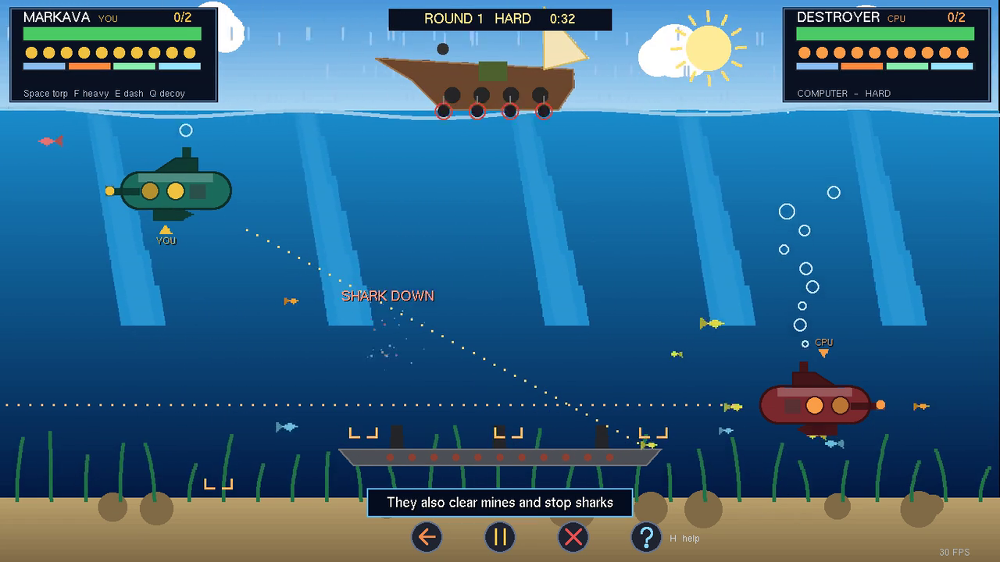 |
| 🛡️ **Shield** | ⚔️ **Battle** |
| 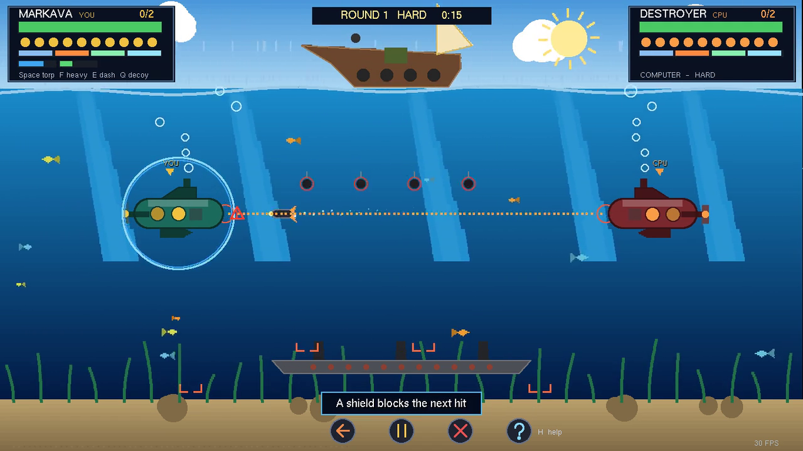 | 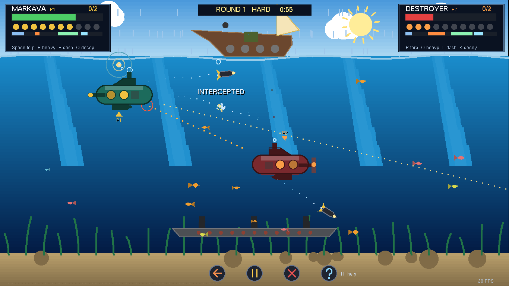 |
| 🌙 **Night & Sudden Death** | 🌊 **A Submarine Sinking** |
| 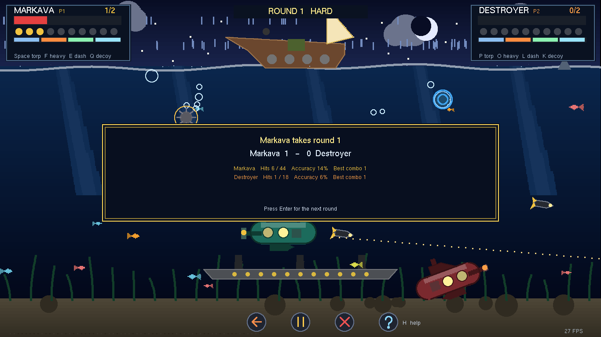 | 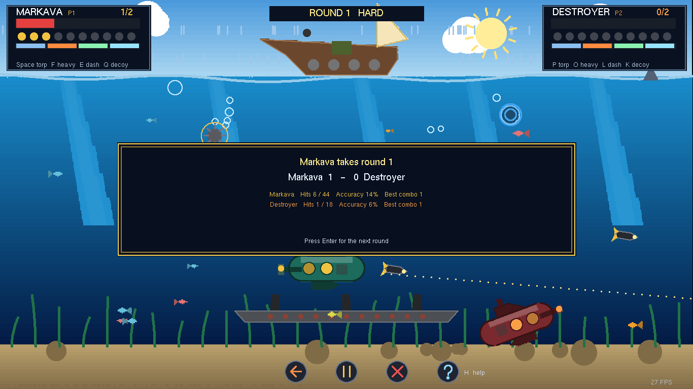 |
| 👥 **Two Players** | 🏆 **Match Result** |
| 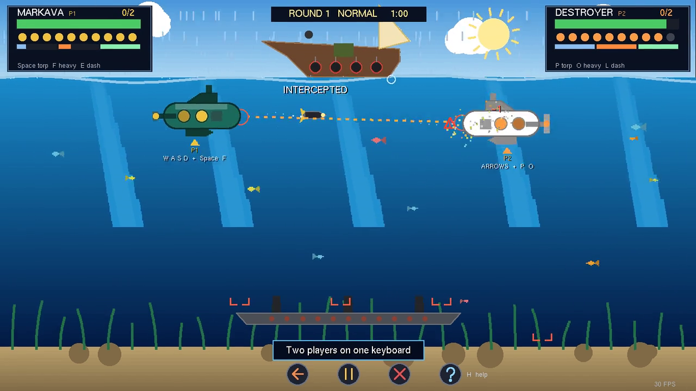 | 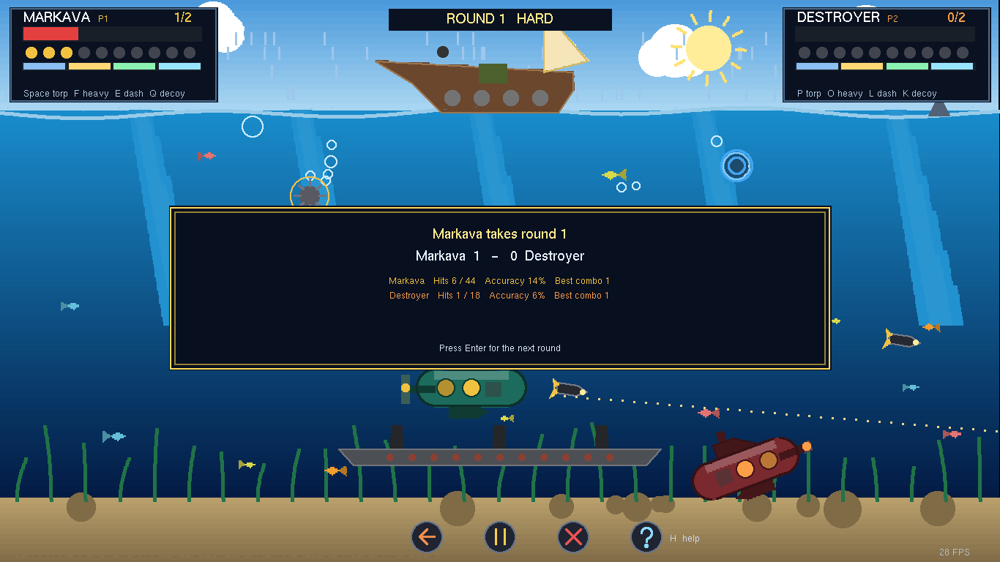 |

</div>

---

## 🧠 Computer Graphics Used

> 🎨 Every shape is drawn with `GL_POINTS` only — built from these algorithms, written from scratch.

| 🧩 Topic | 🎯 Used For |
|---|---|
| 📏 **Midpoint Line** *(8-zone)* | Every line — outlines, arrows, sight, buttons |
| ⭕ **Midpoint Circle** *(8-way symmetry)* | Portholes, bubbles, mines, rings, the sun |
| 🖌️ **Scanline Polygon Fill** | Submarines, fish, shark, boat, title letters |
| ✂️ **Cohen–Sutherland Clipping** | Cutting the aim line to the water |
| ➡️ **Translation** | Moving everything on screen |
| 🔄 **Rotation** | A submarine tilting as it sinks |
| 🪞 **Reflection** | A submarine turning around |
| 🔍 **Scaling** | Heavy torpedo, intro title shrinking |
| 🌈 **Color Interpolation** | Sky & sea gradients, fading effects |
| 🖥️ **Viewport Mapping** | Right shape at any window size |
| ⚡ **Display Lists & Double Buffering** | Smooth ~75 FPS |
| 💥 **Collision Detection** | Exact hit shapes — nothing passes through |

---

## 🛠️ Built With

| | Tool | Used For |
|:---:|---|---|
| 🐍 | **Python 3** | The whole game |
| 🟦 | **PyOpenGL** | Drawing (included in the project) |
| 🪟 | **GLUT (freeglut)** | Window, keyboard and mouse |
| 📦 | **PyInstaller** | Building the Windows `.exe` |

> 🚫 No images · 🚫 No sound files · 🚫 No game engine — **everything is made in code** ✨

---

## 🚀 Getting Started

### 🪟 Option 1 — Just Play (no Python needed)
1. ⬇️ Download the zip from **[Releases](https://github.com/FaiazPronoy/Submarine_Saga/releases/latest)**
2. 📂 Unzip it
3. ▶️ Run `SubmarineSaga.exe`

> ⚠️ Windows may show a SmartScreen warning the first time — click **More info → Run anyway**.

### 🐍 Option 2 — Run from Source
1. Install **Python 3**
2. Clone or download this repository
3. Double-click **`Play Submarine Saga.bat`**, or run:

```bash
python "Submarine Saga (CSE423 Project).py"
```

> ✅ No extra installs — PyOpenGL is already inside the project.

### 📦 Build the `.exe` Yourself
```bash
python -m pip install pyinstaller
packaging\build_exe.bat
```

### 🧪 Run the Tests
```bash
python tests/test_game.py
```
> ✅ **185 automated checks** — graphics algorithms, collisions, game rules and the computer player.

---

## 📁 Project Structure

```
Submarine_Saga/
├── 🎮 Submarine Saga (CSE423 Project).py   # the game
├── ▶️ Play Submarine Saga.bat              # double-click to play
├── 🧪 tests/test_game.py                   # automated tests
├── 📦 packaging/                           # builds the Windows .exe
├── 📚 docs/                                # GIFs, snapshots, development notes
├── 📜 LICENSE                              # all rights reserved
└── 🟦 OpenGL/                              # PyOpenGL library (third party)
```

📘 Want the full story — how it works and every bug we fixed? Read the
**[Development Notes](docs/DEVELOPMENT.md)**.

---

## 👥 Team

<div align="center">

| 👨‍💻 Faiaz Abrar Zaman Pronoy | 👩‍💻 Sinthia Khandoker |
|:---:|:---:|
| **Lead Developer** | **Developer** |
| [@FaiazPronoy](https://github.com/FaiazPronoy) | |

</div>

---

## 📜 License

**© 2024–2026 Faiaz Abrar Zaman Pronoy & Sinthia Khandoker. All rights reserved.**

- ✅ You **can** read the code and play the game for personal use
- ❌ You **cannot** copy, change, share, sell, or submit any part of it as your own work — without written permission

📄 See [LICENSE](LICENSE) for full terms. The bundled `OpenGL/` folder (PyOpenGL & freeglut) is third-party software under its own licenses.

---

<div align="center">

### ⭐ If you enjoyed Submarine Saga, give it a star! ⭐

Made with 💙 by **Faiaz Abrar Zaman Pronoy** & **Sinthia Khandoker**
for 🎓 **CSE423 Computer Graphics** at **BRAC University**

🌊🚢💥🌊

</div>
