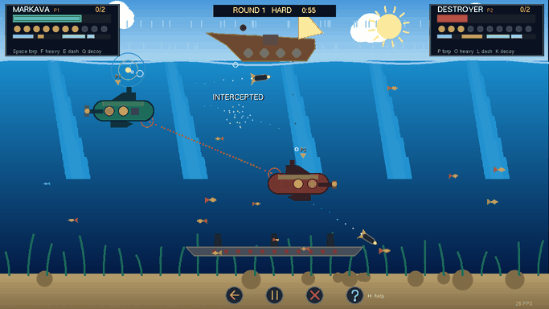

# Submarine Saga - development notes

The full write-up behind the game: how each part works, every bug that was found and fixed, and why things are the way they are. For a short overview, see the [README](../README.md).


A submarine torpedo duel — against the computer or a friend on the same
keyboard — where every pixel on screen is a `GL_POINTS` vertex placed by
algorithms written from scratch: midpoint lines with eight-zone conversion,
midpoint circles with eight-way symmetry, scanline polygon fill, Cohen–Sutherland
clipping, and hand-written translation, rotation and reflection. No `GL_LINES`,
no `GL_POLYGON`, no textures, no image files.

Built as the **CSE423 Computer Graphics** project at BRAC University, in Python
and PyOpenGL.




**[Download for Windows](https://github.com/FaiazPronoy/CSE423_Project_Submarine_Saga/releases/latest)**
— unzip and run `SubmarineSaga.exe`, no Python needed.

### Highlights

- **An animated intro** in a pixel font drawn from scratch: a sonar ping
  spreads through the water and each letter rises out of it as the ping
  reaches it, a submarine glides past, a glint runs over the name, and then
  the lettering shrinks and slides up to become the title screen's heading.
- **A computer opponent that plays fair** on three levels: it looks for you
  every so often and aims where it last saw you, so moving keeps you alive.
- **Two torpedoes** — a quick light one and a heavy one that homes and blasts —
  plus decoys, dash, pickups, drifting mines, a shark, depth charges and a wreck
  to hide behind.
- **Exact collisions**: the hit shapes are the hull's own polygons and circles,
  and a torpedo is tested along the capsule it swept, so nothing tunnels
  through anything at any frame rate.
- **About 75 frames a second** in pure Python: each shape's `glVertex2f` calls
  are recorded once into a display list and replayed.
- **177 automated checks**, including the rasterisation algorithms themselves,
  and a 21,000-frame random input stress test.

| | |
|---|---|
|  |  |
|  |  |

---

## Running it

**Without Python:** download the Windows zip from the
[latest release](https://github.com/FaiazPronoy/CSE423_Project_Submarine_Saga/releases/latest),
unzip it anywhere and run `SubmarineSaga.exe`. Windows may show a SmartScreen
warning the first time, because the program is not signed; choose
*More info → Run anyway*.

**With Python 3:** on Windows, double click **`Play Submarine Saga.bat`**. It
finds Python and starts the game, and if the game stops with an error the
window stays open so the message can be read.

Or from a terminal:

```bash
python "Submarine Saga (CSE423 Project).py"
```

Nothing has to be installed: the `OpenGL` folder beside this file is a copy of
PyOpenGL, and Python finds it because it sits next to the script.

Nothing else is needed — not even `numpy`.

## Modes

The title screen has three rows:

- **1 PLAYER** against the computer. The computer plays through the same
  controls as a person, and it does not cheat: it does not see you all the
  time. It looks every so often (every 1.5 s on EASY, 1 s on NORMAL,
  0.55 s on HARD) and aims at where you were when it last looked, its tube
  turns at its own rate, it gets no aim snap, and it has to wait between
  shots. So a player who keeps moving is one it has to hunt — fire, then move,
  and its torpedo goes where you used to be. It dodges torpedoes it sees
  coming, drops decoys against heavy torpedoes, fires heavy torpedoes of its
  own, goes for pickups and uses its dash. Wins and losses against each level and your
  best win streak are saved in `submarine_saga_save.json` beside the game.
- **2 PLAYERS** on one keyboard.

Both rows have a level, EASY, NORMAL or HARD (`A`/`D` or the arrows change
it), and the level decides what you play with as well as how good the computer
is:

| | EASY | NORMAL | HARD |
|---|---|---|---|
| Light torpedo | yes | yes | yes |
| Heavy torpedo, 3 damage | – | yes, runs straight | yes, homes in |
| Heavy torpedo's blast | – | – | yes |
| Decoy | – | – | yes |
| The computer | slow, loose aim | quicker | sharp, dodges and uses decoys |

EASY is the plain game, one kind of torpedo, for learning to aim. Everything
else — ten lives, the aim that holds its angle, the snap, dash — is on every
level. The HUD shows the level in the middle and only the reload bars the
level has; the help screen greys out what it does not.
- **HOW TO PLAY**, the help screen. `H` or `F1` opens it from anywhere, and it
  pauses a game in progress.

## Controls

| | Left submarine (Markava) | Right submarine (Destroyer) |
|---|---|---|
| Move, and swing the torpedo tube | `W` `A` `S` `D` | arrow keys |
| Light torpedo (hold to keep firing) | `Space` or `C` | `P`, `Enter` or numpad `0` |
| Heavy torpedo (NORMAL, HARD) | `F` | `O` or numpad `1` |
| Dash | `E` or `V` | `L` or numpad `.` |
| Decoy (HARD) | `Q` | `K` or numpad `2` |

Against the computer you are Markava, and either set of keys steers you.

The controls are shown on the title screen, in each corner panel during the
game, and next to each submarine at the start of every round.

**The torpedo tube has its own angle.** The movement keys swing it round
towards the direction they point, and when you let go it **stays** at the
angle it had reached. So you can set an angle, stop, and fire; or back away
from the other player while still aiming at them. The hull turns round to face
wherever the tube points, so a torpedo always leaves from the nose.

The dotted line out of the nose is the **sight**, and it is not decoration: it
walks the exact path the next light torpedo would take and stops at the first
thing that path runs into — the wreck, a mine, the seabed, the edge of the map.
When what it stops on is the other submarine, it turns red and puts a ring on
the target. **Close is good enough:** a player's shot within 9° of the other submarine
snaps onto it, and the sight shows the snapped line, so diagonal and corner
shots do not need the exact degree.

### Two torpedoes

| | Light | Heavy |
|---|---|---|
| Damage | 1 | 3, and 1 more from the blast to anyone near it |
| Reload | 0.6 s | 3 s |
| Speed | 430 — about three seconds to cross the map | 300 |
| Path | straight | straight on NORMAL; on HARD turns gently towards the target it can see ahead |
| Level | all | NORMAL and HARD |

The heavy torpedo is the one worth waiting for: its reload bar in the corner
flashes when it is ready. On HARD it homes, and there it has an answer — the **decoy**,
a noise maker you drop behind you. A heavy torpedo that can hear a decoy goes
for it instead. Dodging still works too: it only turns so fast, so crossing in
front of it quickly or getting out of its cone shakes it off. Its blast hurts
whoever is close, the one who fired it included.

Firing kicks the submarine back a little, the heavy torpedo more so. A light
torpedo shoots a heavy one down, which is often the cheapest defence.

`Enter` start / next round · `I` pause · `R` restart the match ·
`H` help · `M` sound on/off · `N` day and night · `Esc` back to the menu.
The four buttons along the bottom do restart, pause, quit to the menu and help.

## How a match works

Each submarine starts with **ten lives**. Lose them all and you sink, and the
other player takes the round. **First to two rounds wins the match.** The score
sits next to each name in the corner panels.

A round opens with **READY**, when you can swim but not fire, then **GO**.
After a minute it goes to **SUDDEN DEATH**: the depth charges fall faster and
the mines come twice as often, so no round drags on. Hits in a row without a
miss count up as a combo, and the match result shows each player's hits,
accuracy and best combo.

Things that will hurt you:

- **Torpedoes** from the other player, in whatever direction they were heading
- **Depth charges** from the boat above, 2 damage. A yellow bracket marks the
  sand where each one is going to land, so the pass can be read before it
  arrives
- **Drifting mines**, 2 damage. A tightening ring means one is still arming and
  cannot hurt you yet; a blinking ring means it is about to expire
- **A shark**, 1 damage. A fin cuts the surface a second before it appears

Nothing here is only a hazard. **A torpedo destroys a mine, kills a shark,
sets off a depth charge, and shoots down another torpedo**, so the things in
the water are something to use rather than only something to survive.

The **wreck on the seabed is solid.** Torpedoes and depth charges break against
it, so it is real cover, and submarines stand on its deck rather than passing
through it — the middle of the map has a floor seventy units higher than the
sand either side of it. Standing on the wreck is a better firing position and a
worse hiding place, which is the only reason the map has terrain at all.

With two lives or fewer you are on your **last stand**: you move faster and
reload faster, and pickups start falling on your side. A damaged hull trails
smoke, so how hurt the other player is shows on their submarine too.

Things worth swimming for — they fall from the surface and drift as they go:

| | |
|---|---|
| red cross | three lives back |
| blue ring | a shield that absorbs the next hit |
| yellow bolt | rapid fire, half the usual reload for both torpedoes |
| green arrow | a speed boost |

## Computer graphics in the game

Everything on screen is `glBegin(GL_POINTS)` and `glVertex2f`: no other
primitive, and no vertex arrays. Tests check both in the source.

| Technique | Where |
|---|---|
| Midpoint line with the eight zone conversions | `MidPointLine`, `findZone`, `convertToZone0`, `convertToZoneM`, used by `draw_lines` for every edge, spike, arrow and key cap |
| Midpoint circle with eight way symmetry | `MidPointCircle`, `zone_converter`; `draw_arc` draws chosen octants only, for the hull outline and the `?` button |
| Filled circles | `disc_points`, spans between the midpoint circle's points |
| Scanline polygon fill (even–odd rule) | `scanline_points`, `fill_polygon` — hulls, fish, the shark, the boat |
| Translation | `submarine.move_by` by hand; and `glTranslatef`, which moves a shape rasterised once to wherever it is drawn |
| Scaling, and interpolating between two layouts | the intro's lettering shrinks and slides from its big layout to the title screen's (`lerp_layout`), and the menu panel opens out from its centre |
| A pixel font of its own | `TITLE_FONT`, `glyph_part`, `draw_title` — 5 × 7 glyphs, each lit cell a scanline-filled square with a stepped extrusion behind it and a gold-to-orange gradient |
| Rotation about a point | `submarine.rotate_by`, the sinking hull; the hit shape turns with it |
| Reflection | `submarine.flip`, x → 2cx − x, how a submarine turns round |
| Colour interpolation | `mix`, `fill_gradient` — sky, water and sand gradients, fading particles |
| Orthographic projection and window → world mapping | `glOrtho` in `display`, `convert_coordinate` for the mouse, screen shake as a projection offset |
| Cohen–Sutherland line clipping | `region_code`, `cohen_sutherland` — the sight's line of fire is clipped to the water, so it ends exactly on the wall, the surface or the sand |
| Collision geometry | point in polygon by ray casting, segment–segment and segment–polygon distance, swept capsules (`capsule_hits_shape`) |
| Display lists and double buffering | every shape's `glVertex2f` calls are recorded once and replayed with `glCallList`; the sky, sea, wreck and HUD panels are baked whole; `GLUT_DOUBLE` |
| Particle systems and dt based animation | explosions, bubbles, trails, smoke, rain |

## What changed in the fifth version

**An intro.** The game opens on a four-second intro — press any key or click to
skip it. A sonar ping spreads from the middle of the water, and each letter of
the name rises out of the water as the ping reaches it, swaying with the
waves; a submarine glides past underneath, a glint runs across the name, and
then the lettering shrinks and slides up while the title screen's panel opens
out behind it. The name is in a pixel font of the game's own — GLUT's bitmap
fonts cannot be scaled — and the same lettering is the title screen's heading.

**Text in one call.** A line of text was drawn one `glutBitmapCharacter` call
per letter, which was most of the title screen's frame time. It is now one
`glutBitmapString` call per line, falling back to per character where plain
GLUT does not have it.

## What changed in the fourth version

**Only glBegin and glVertex2f.** Points used to go to OpenGL as vertex arrays
(`glDrawArrays`), which some courses do not allow. Every point is now a
`glVertex2f` between `glBegin(GL_POINTS)` and `glEnd`. A frame has about
37,000 points and a Python call per point costs about a microsecond, so each
shape's calls are recorded into a display list the first time it is drawn,
and after that it is replayed with `glCallList`, moved into place with
`glTranslatef`. Points that change every frame — particles, rain, the sight —
go straight out as `glVertex2f`. Rendered side by side in the same frame, the
two versions differ in no pixel at all, and the frame time is about the
same. `numpy` is no longer used.

**Aiming was hard, and firing was too fast.** A torpedo went the way the
submarine was moving, so an angled shot meant swimming at that angle and
firing before the submarine stopped, and the torpedo crossed the whole map in
just over a second. The tube now has its own angle that stays where you leave
it, shots within 9° of the target snap onto it, and torpedoes run at 430
(light) and 300 (heavy) instead of 1000 — slow enough to see coming and dodge.

**The computer always had you in its sights.** It turned its tube to your
exact position every frame, got the same aim snap a player gets, and fired the
moment its sight locked, so moving did not help: every shot landed. Now it
only looks for you every so often and aims at where you were, turns at its
own rate, gets no snap, and waits between shots.

**One kind of shot.** There are now two, depending on the level: a light torpedo on a quick reload and
a heavy one that does three times the damage, homes, and blasts on a near
miss, with the decoy as its counter.

**A warning before a hit.** A torpedo that will reach you within a second
puts a blinking red warning on the side of your submarine it is coming from,
so there is time to move. It shows only on submarines a person is steering.

**Fish swam tail first.** Every fish's tail was drawn on the side it was
swimming towards.

**Popups printed over each other** when a submarine was near the surface.
They now start low enough to stay in the water and stack downwards.

**Line clipping.** The sight's line of fire is clipped to the water with the
Cohen–Sutherland algorithm before it is walked.

**Fireworks** in the winner's colours over the match result.

**Rounds were over too soon.** Ten lives instead of five, with hazards that
hurt in proportion: mines and depth charges 2, the shark 1, a health pickup
gives 3 back.

## What changed in the third version

**It told you nothing about how to play.** The controls were one line on the
title screen and nowhere else. They are now drawn as keys on the title screen,
on a full help screen (`H`), in each corner panel, and next to each submarine
at the start of every round, with a READY count so there is time to read them.

**It needed two people.** There is a computer opponent with three levels, and
a saved record against each.

**Speed.** A frame took 37 ms to draw. Shapes are now rasterised once, relative
to their own origin, and translated into place, and PyOpenGL's per call error
check is off. The same frame takes about 12 ms.

**Controls.** Holding fire keeps firing. There is a dash. Pushing against your
own motion gets extra thrust and a released axis brakes, so the submarine
answers the keys instead of drifting. It turns round when it swims backwards,
so the nose — and the torpedo tube — points the way it is going.

**Collisions are exact.** The hit shape is the hull's own polygons and its
round caps, not a box round them: the nose and tail caps used to be outside it
entirely, and the empty water above the tail used to be inside it. A torpedo is
tested as the capsule it swept since the last frame, from its tail to its nose,
so it hits the frame its nose touches and cannot skip over the thin periscope
however long the frame was. Depth charges are swept the same way.

**Borders.** The walls, the surface and the seabed are measured on what is
drawn: a submarine goes right to the edge of the window, the periscope reaches
the waterline, the keel sits on the sand. A torpedo ends where its nose meets
the surface or the sand, with a splash, rather than flying on into the sky.

**Bugs fixed.** Player two's propeller shaft was drawn from the nose and cut the
hull in half. Whole circles were drawn at each end of the hull's outline, so
two arcs crossed its middle. Swimming along the seabed into the wreck made a
submarine jump seventy units up the moment its centre crossed the edge; the
wreck is now a solid block with sides. The two submarines passed through each
other; they now bump. The reload bar ignored the last stand's faster reload.
Pickups vanished the instant they reached the bottom; they now wait there.

**Full screen showed a grid.** Every fill is rows of points a few units
apart, each point exactly as wide as the gap, and point sizes are in pixels.
Maximise the window and the world stretched but the points did not, so the
gaps showed as a grid across the whole picture, and circles went oval. The
world now keeps its shape with black bars on the spare sides, point sizes
are scaled by the window's pixels per world unit, the baked display lists are
rebuilt on a resize, and the mouse and text use the same mapping.

**Feel.** A hit freezes the action for a blink and the last hit plays out in
slow motion. Hits, blocks, combos, interceptions and pickups show as floating
text, damaged hulls smoke, and on Windows there is sound (`M` turns it off).

## What changed in the second version

The first version worked, but it was too slow to play and both submarines were
the same colour, so you could not tell which one was yours.

Timing `display()` on my laptop, best of six runs of thirty frames each,
alternating between the two builds so they meet the same conditions: the first
version lands between 155 and 261 ms a frame, this one between 28 and 41. The
absolute numbers move around with whatever else the machine is doing, but the
gap does not — **it is about six times faster**, and it is the difference
between a slideshow and something you can play.

**Speed.** `draw_points` opened and closed a `glBegin`/`glEnd` block for every
single point, and the whole screen is points. Points are now collected into
runs of the same colour and size and sent as one vertex array each, and the
midpoint circle results are cached because the same radius comes up every
frame. The algorithms themselves are untouched — the same points end up on
screen, in the same order.

**Movement.** A key press moved a submarine a fixed twenty units, so how fast
you travelled depended on the operating system's key repeat rate, and holding a
key gave a stutter. Keys now set an intent, and a physics step runs once a
frame with acceleration, drag and walls, so a submarine builds up speed and
coasts when you let go.

**Aiming.** Torpedoes steered themselves to the other player, so firing was
never a decision — you held the key down and thought only about dodging. They
now go where you are pointing. That also fixed two bugs the auto-aim was
hiding: player two's torpedoes climbed when they should have dived, because the
vertical component was negated twice, and firing while the two submarines were
on the same vertical line divided by zero and killed the game.

**Collisions.** `get_bounding_box` returned the centre of the hull while
`has_collided` expects the bottom left corner, so every box test in the game was
off by half a submarine. The hit radii were also three to ten times the size of
the thing being drawn — a depth charge is 7 pixels across and killed you from
70 away. Every radius now matches the art and lives beside the other tunables at
the top of the file.

**Taking four hits in one frame.** Nothing stopped the torpedoes, the depth
charges, the mines and the shark from all calling `damage()` on the same frame,
so you could lose four of five lives at once with a single flash to show for it.
A hit now grants a short moment of invulnerability.

**Depth charges going to infinity.** The sideways speed was `1/tan(angle)` with
the angle picked from a sixty degree range. At some angles a charge fell dead
straight; at others it crossed the map in a single frame and was gone before it
could be seen. It is a plain horizontal speed now.

**Diagonal movement was 41% faster**, because the speed cap was applied to each
axis separately. Travelling at an angle was strictly the best way to move.

**Keys sticking down.** Alt tab while holding a key and the key up event went to
the other window, so the submarine accelerated into the wall for ever. The held
keys are dropped when the pointer leaves the window, and `glutIgnoreKeyRepeat`
stops the auto repeat making the held key set flicker. GLUT has no focus
callback, so leaving the window is the closest signal there is.

**Bookkeeping.** Bubbles, sharks, spent torpedoes and used pickups were never
removed from their lists, so a long game got slower and slower.

**Drawing.** `draw_filled_shape` only ever drew the outline of a shape, which
is why the submarines looked like wireframes. There is a scanline fill now, so
a hull is a hull, and the function is called `draw_outline` because that is
what it does.

**Circles with eight notches in them.** The midpoint circle loop ran
`while x < r`, which stops one pixel before the octant reaches the 45 degree
diagonal, and the eight mirrored copies each end one pixel short of their
neighbour. Measuring the largest gap between neighbouring pixels across radii
3 to 95: worst case **2.83 pixels before, 1.41 after**, 45 radii improved and
none made worse. The condition is `while x <= r`.

**Torpedoes passing through each other.** Collisions were tested where a
torpedo *ended* the frame, not where it *travelled*. A torpedo covers 50 units
in a frame and the interception radius is 26, so at a low frame rate two
torpedoes swapped places without ever being close enough to notice. Firing 60
head-on pairs: **27 of 60 passed straight through at 20 fps, 14 of 60 at 30**.
The test is now the distance from the other torpedo to the *segment* the
torpedo covered, and it is 0 of 60 at every frame rate I tried.

**Caps lock broke half the keyboard.** The movement keys were lowered before
being compared and the action keys were not, so with caps lock on both players
could swim and neither could shoot, pause or restart.

**A third of each submarine could not be hit.** `get_bounding_box` was built
from the hull and the keel only, so the conning tower and the periscope — 35 of
the 100 units you can see — were outside every collision shape. The propeller
is still left out, deliberately: it is a thin spinning blade and clipping it
should not cost a life.

**The shark bit with its middle.** It was one circle of radius 26 at its centre
while the drawing runs 46 units ahead of that centre, so the teeth reached
about 20 units past anything that could register. Nose and body get a circle
each now.

**The wreck was a hiding place with no way in.** It was drawn *after* the
submarines, so it painted over them; and its box covered the whole band the
seabed clamp puts a hull in, so a player parked on the sand inside it could not
be reached by a torpedo or a depth charge. The box is now the drawn hull only,
the wreck has its own slot in the draw order — behind the submarines, in front
of the weeds — and it is solid ground rather than a room.

**Pausing banked up the game.** Reload and spawn deadlines are wall clock
stamps, and the wall clock does not stop when the game does. A thirty second
pause left every timer overdue, so unpausing dropped a mine, a shark and both
players' torpedoes into the same frame.

**A shield cost a life anyway.** Breaking a shield returned before granting the
moment of invulnerability an ordinary hit grants, so a second hazard in the
same frame went straight through and the shield read as having done nothing.

**Power up bars all divided by seven** while a shield lasts nine seconds and
rapid fire six, so a fresh shield overflowed its bar and rapid fire started
already a seventh spent. The three durations are named constants the HUD reads.

**A hull went down flat**, translated straight to the seabed like something
being lowered on a rope. It turns as it falls now — a plain 2D rotation of
every point about the average of the four hull corners, which is the one point
a rotation leaves where it is. About thirty degrees over the whole way down.
Nothing else in the game rotates: every hit box is axis aligned, and a tilted
hull would not be tested honestly, but by the time this runs the submarine is
out of the round and nothing is testing it.

**The result banner could not be read.** Whoever just lost is usually still
leaning on a key, and the next round started before either player saw who won.
A result screen ignores input for its first 0.7 seconds and the held keys are
released when a round ends.

**New:** heading based aiming with a sight that traces the real path of the
shot, torpedoes that destroy mines, sharks and each other, the wreck as cover
and as ground you can stand on, warning markers on the depth charges
and the shark, a last stand for whoever is behind, the round and match system,
the title screen, four kinds of pickup instead of one, mines that arm and
expire, explosion particles, fish, seaweed, light shafts, a depth gradient, a
wavy surface, screen shake, and a head up display with health, lives, reload
and the power ups that are running.

## Layout

```
Submarine Saga (CSE423 Project).py
├── viewport                fit_viewport, convert_coordinate, point_px
├── point batching          draw_points_batch, flush_points, emit_points,
│                           Shape / Placed / shape_list (display lists)
├── midpoint line           MidPointLine, findZone, convertToZone0, convertToZoneM
├── midpoint circle         MidPointCircle, zone_converter, disc_points, draw_arc
├── shape helpers           draw_lines, draw_filled_circle, scanline_points,
│                           fill_polygon, fill_gradient
├── geometry                point_in_polygon, seg_seg_dist, capsule_hits_shape,
│                           cohen_sutherland
├── background              sky, water, seabed, seaweed, light rays, sun and moon
├── sound                   synthesised effects, play
├── entities                Torpedo, Decoy, Bubble, rain, Particle, Fish, Mine,
│                           UniqueCircle, Shark, submarine
├── HUD                     health, lives, reloads, power ups, warnings, popups
├── rounds                  start_round, end_round, next_round, reset_game
├── input                   BINDINGS, apply_input, aim_of, fire, aim_trace
├── computer opponent       CPU_LEVELS, cpu_update
├── screens                 menu, help, pause, round and match results
└── frame                   display, animate, GLUT callbacks
```

## Tests

`tests/test_game.py` drives the game without anyone at the keyboard: it starts
matches, holds keys, fires, takes damage, wins rounds, and checks the results.

```bash
python tests/test_game.py
```

It works from any directory: the test puts the project root on the import
path itself, so the bundled `OpenGL` copy is found.

**177 checks, all passing.** They cover:

- the graphics algorithms themselves — the midpoint line joins both ends with
  no gaps in all eight zones, every midpoint circle point sits on the radius and
  the circle is symmetric, the scanline fill stays inside its polygon,
  Cohen–Sutherland keeps, rejects and cuts lines correctly — and that only
  `glBegin(GL_POINTS)` and `glVertex2f` are used to draw;
- collisions and borders — the exact hit shape, swept torpedoes, the walls, the
  surface, the wreck's deck and side, bumping, a maximised window;
- the intro — it ends by itself, any key or click skips it without doing
  anything else, the lettering sits inside the title panel;
- the game — rounds, matches, pause, help, pickups, both torpedoes, homing,
  decoys, blast, dash, the READY count, what each level has, the computer's
  fairness, the record file;
- one check per bug fixed, so none of them can come back quietly.

Beyond the checks, the game has been driven by a random input tester for
21,000 frames — random keys in every state, random mouse clicks, random window
sizes, forced hits so rounds and matches end — checking every frame that
nothing throws, no submarine leaves the water or ends up inside the wreck,
lives stay in range, no number goes NaN, and no list grows without limit.
Nothing was found.

## Building the Windows version

`packaging\build_exe.bat` turns the game into a folder that runs without
Python, using PyInstaller, and zips it for sharing:

```bash
python -m pip install pyinstaller
packaging\build_exe.bat
```

The result is `packaging\dist\SubmarineSaga\SubmarineSaga.exe` and
`packaging\dist\SubmarineSaga-Windows.zip` (about 15 MB). The build takes
the whole bundled PyOpenGL package with `--collect-all OpenGL`, because
PyOpenGL loads its platform code by name at run time and `glutInit` needs the
freeglut DLL that ships inside it. In the built version the record file is
kept next to the `.exe`.

## Known limitations

- Sound is Windows only, through the `winsound` module that ships with Python.
  GLUT has no audio of its own. Windows plays one sound at a time.
- Two players share one keyboard; there is no network play. Some keyboards
  cannot report many keys held at once, which can drop a key when both players
  press several together.
- The frame rate depends on the graphics driver, because everything is drawn as
  individual points. It is comfortable on a normal laptop and slow inside a
  virtual machine with software rendering.

---

Copyright (c) 2024-2026 Faiaz Abrar Zaman Pronoy and Sinthia Khandoker. All rights reserved. See [LICENSE](../LICENSE).
